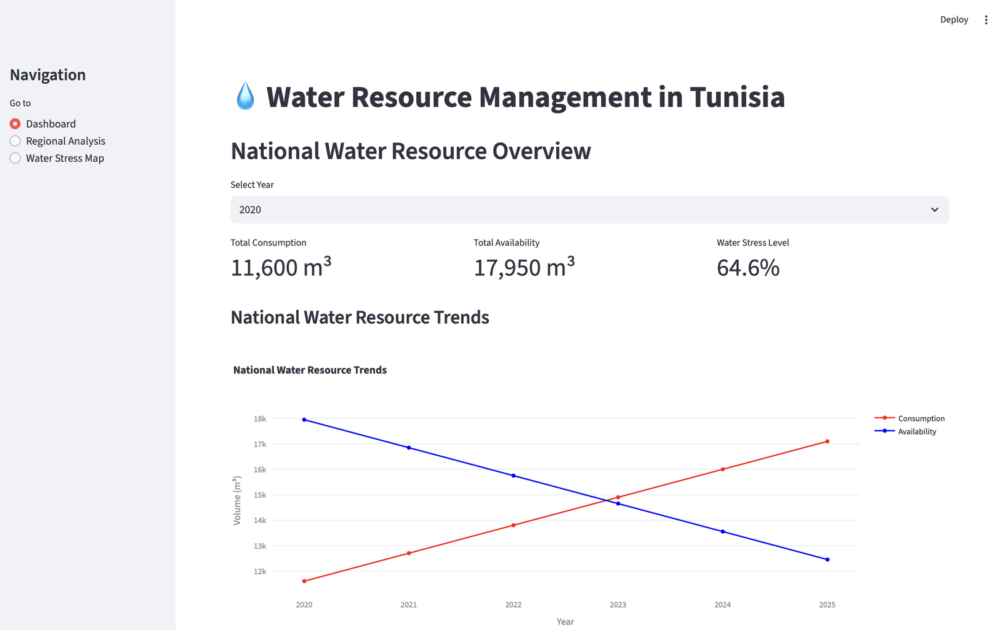
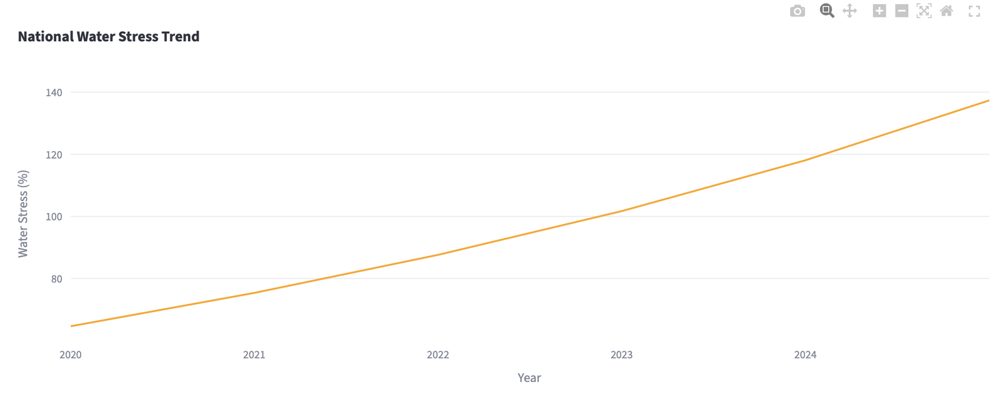
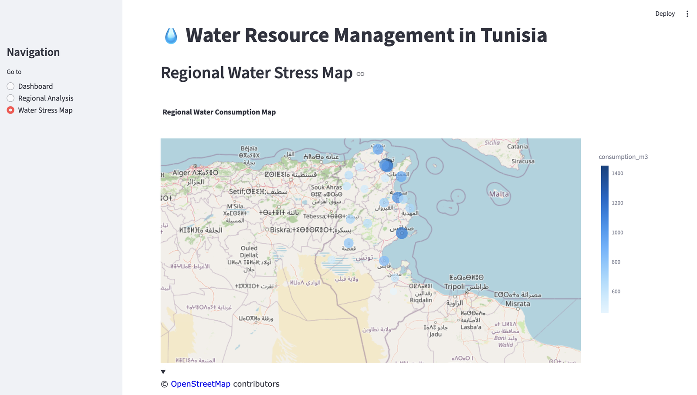
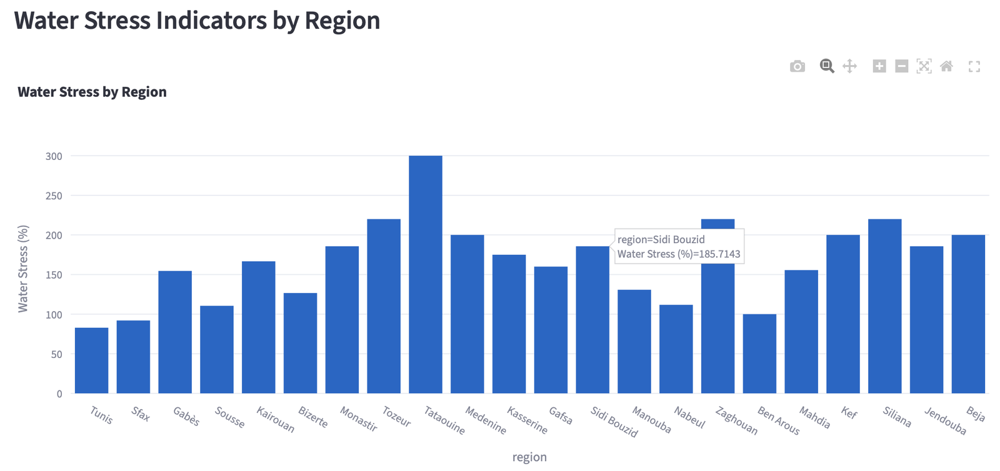

<p align="center">
  
</p>

<h1 align="center">Water Data – Analyse des ressources hydriques en Tunisie</h1>

<p align="center">
  <b>Projet universitaire · Data Science · Analyse et visualisation de données</b>
</p>

<p align="center">
  
  
  
  
  
</p>

---

## Présentation du projet

Projet réalisé dans le cadre du module de Data Science à l'IHEC Carthage (2024-2025).

L'objectif est d'analyser la consommation et la disponibilité de l'eau dans **22 gouvernorats tunisiens** entre **2020 et 2025**, d'identifier les régions en situation de stress hydrique, et de présenter les résultats dans une **application web interactive**.

## Indicateur clé : le stress hydrique

Pour chaque région et chaque période, le projet calcule :

**Stress hydrique (%) = consommation / disponibilité × 100**

Au-delà de 100 %, la région consomme plus d'eau qu'elle n'en a de disponible : elle est en situation de pénurie.

## Application Streamlit

L'application (`app.py`) est organisée en trois pages :

- **Dashboard** : vue nationale pour l'année choisie (consommation totale, disponibilité totale, niveau de stress hydrique) et évolution des tendances d'une année à l'autre.
- **Regional Analysis** : indicateurs moyens d'une région au choix, son évolution dans le temps, et comparaison de toutes les régions pour une année donnée.
- **Water Stress Map** : carte interactive de la consommation par région et classement des régions selon leur stress hydrique.

### Dashboard : vue nationale


### Évolution du stress hydrique national


### Carte de la consommation par région


### Stress hydrique par région


## Notebook d'analyse

Le notebook `projet_water.ipynb` reprend l'analyse exploratoire :
- chargement et nettoyage des données ;
- consommation moyenne par région ;
- nombre de mois où la consommation dépasse la disponibilité ;
- graphique comparatif consommation / disponibilité ;
- carte Folium des régions, en rouge lorsque la consommation dépasse la disponibilité.

## Contenu du dépôt

| Fichier | Rôle |
|---|---|
| `app.py` | Application web interactive (Streamlit) |
| `projet_water.ipynb` | Notebook d'analyse exploratoire |
| `water_data.csv` | Jeu de données : date, région, consommation, disponibilité, coordonnées |
| Rapport (Word) | Rapport détaillé du projet |
| `images/` | Image de couverture et captures |

## Technologies

- **Python** : Pandas pour le traitement des données
- **Streamlit** : application web interactive
- **Plotly** : graphiques et carte interactifs
- **Folium** : carte dans le notebook
- **Jupyter Notebook** : analyse exploratoire

## Lancer l'application

```bash
pip install streamlit pandas plotly
streamlit run app.py
```

Puis ouvrir [http://localhost:8501](http://localhost:8501)

## Autrice

**Rania Ben Brahim** — Licence Business Intelligence, IHEC Carthage
